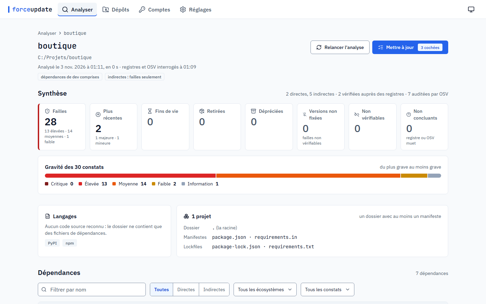
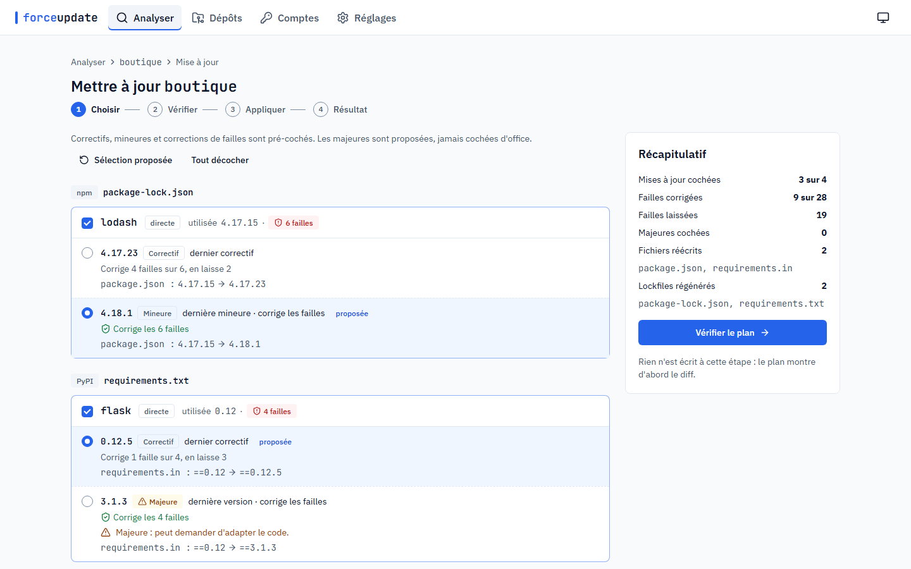
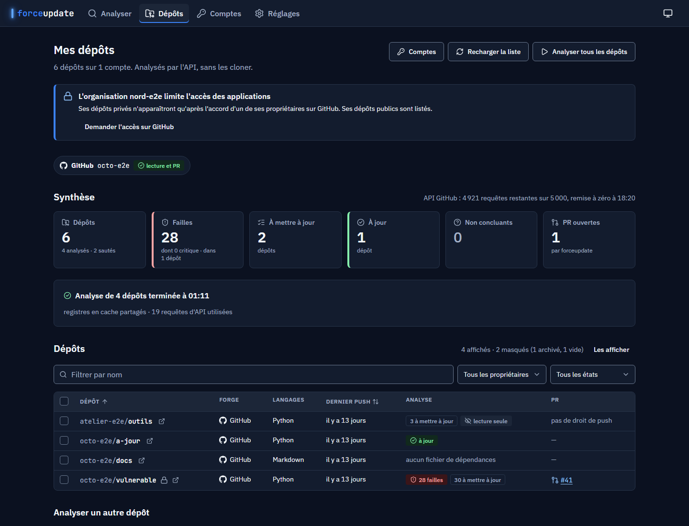
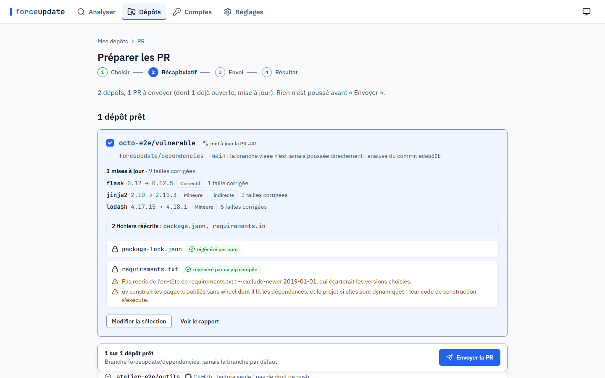
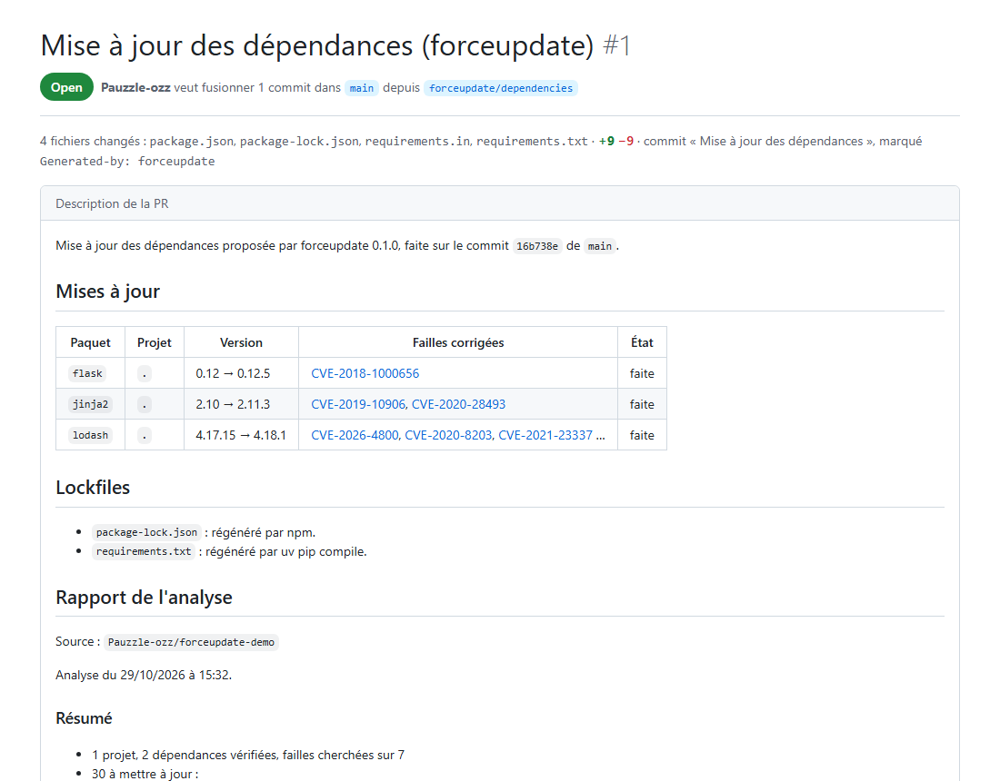

# forceupdate

On donne du code à forceupdate : un dossier, un fichier, ou tous ses dépôts GitHub, GitLab et
Bitbucket. Il repère les langages et les dépendances, et dit ce qui doit être mis à jour :
failles connues, fins de vie, versions retirées ou dépréciées, versions plus récentes. Puis il
fait les mises à jour cochées : en local, il réécrit les fichiers et régénère les lockfiles ;
sur une forge, il ouvre une pull request par dépôt.

Tout se passe dans une interface web qui tourne sur son ordinateur (`forceupdate ui`), ou en
ligne de commande (`forceupdate scan`, `forceupdate update`) pour les scripts et la CI. Huit
écosystèmes : Python, JavaScript (npm, Yarn, pnpm), Rust, Go, PHP, Ruby, Java (Maven, Gradle)
et .NET. Interface et messages en français. Licence MIT.



## Installation

Avec [uv](https://docs.astral.sh/uv/) :

```bash
uv tool install forceupdate
```

ou `pipx install forceupdate`. Python 3.11 ou plus récent ; Windows, Linux ou macOS. L'interface
est livrée dans le paquet : node n'est pas nécessaire.

La 1.0.0rc1 est une pré-version : `uv tool install forceupdate==1.0.0rc1` (ou `--prerelease
allow`) tant que la 1.0.0 n'est pas publiée.

Ce qu'il faut en plus, selon l'usage :

- **git**, pour ouvrir des PR (forceupdate clone, commite et pousse) et pour le garde-fou des
  mises à jour locales ;
- **l'outil de chaque lockfile** (npm, pnpm, Yarn, uv, Poetry, PDM, pipenv, pip-compile, cargo,
  go, Composer, Bundler, dotnet), pour le régénérer ; sans lui, forceupdate réécrit les
  manifestes et donne la commande à lancer.

## Démarrer

```bash
forceupdate ui
```

Le serveur démarre sur `127.0.0.1` (jamais sur le réseau), et le navigateur s'ouvre sur
l'interface. L'adresse porte un jeton de session : seul qui l'a peut s'en servir. Ctrl+C
l'arrête.

1. **Analyser** : choisir un dossier ou un fichier de l'ordinateur (ou le déposer sur la page).
   Le rapport range les constats du plus grave au moins grave, avec le détail de chaque
   dépendance.
2. **Mettre à jour** : les mises à jour sûres sont cochées d'office (correctifs, mineures,
   corrections de failles), les majeures sont proposées sans être cochées (sauf si on le
   règle). On lit le diff de chaque fichier et les lockfiles qui seront régénérés, puis on
   applique.
3. **Mes dépôts** : connecter son compte GitHub, GitLab ou Bitbucket, analyser tous ses dépôts
   sans les cloner, puis ouvrir une PR (une MR sur GitLab) par dépôt.





Avant l'envoi, le récapitulatif dit ce que chaque PR contiendra ; rien ne part avant
« Envoyer ». La PR vit sur la branche `forceupdate/dependencies`, jamais sur la branche par
défaut ; relancé, forceupdate met à jour la même PR.





Les captures viennent du serveur des tests de bout en bout (données enregistrées, forge
simulée), sauf la dernière : la description de la PR #1 du dépôt de test, rendue par GitHub.

## En ligne de commande

```bash
forceupdate scan .                                 # le rapport dans le terminal
forceupdate scan . --format json -o rapport.json   # ou --format md ; toujours en UTF-8
forceupdate scan . --fail-on vuln                  # code 1 si une faille est connue

forceupdate update . --dry-run                     # le plan et le diff, sans rien écrire
forceupdate update .                               # correctifs et mineures, après confirmation
forceupdate update . --security-only --yes         # seulement les failles, sans demander
```

Codes de retour : 0 rien à signaler, 1 seuil de `--fail-on` atteint, 2 erreur (dont un refus
du garde-fou git, ou un lockfile que son outil n'a pas pu régénérer). Toutes les options sont
dans [docs/USAGE.md](https://github.com/Pauzzle-ozz/forceupdate/blob/main/docs/USAGE.md#la-ligne-de-commande).

## Ce qui part sur le réseau

forceupdate ne lit le code que sur l'ordinateur. Il envoie les noms et les versions des
paquets aux registres (PyPI, npm, crates.io, proxy Go, Packagist, RubyGems, Maven Central,
nuget.org, ou les registres privés déclarés), à [OSV](https://osv.dev) pour les failles, et
les noms des runtimes et des frameworks à [endoflife.date](https://endoflife.date). Un
paquet privé n'est jamais demandé au registre public ni à OSV. Les tokens des forges restent
dans le trousseau du système, jamais dans le navigateur.

## Les écosystèmes

| Écosystème | Manifestes | Lockfiles régénérés par |
|---|---|---|
| Python | `requirements*.txt` et `.in`, `pyproject.toml` (PEP 621, Poetry, uv, PDM), `Pipfile`, `setup.cfg`, le bloc PEP 723 d'un script | uv, Poetry, PDM, pipenv, pip-compile |
| JavaScript | `package.json`, `pnpm-workspace.yaml` | npm, pnpm, Yarn 1 et 2+ |
| Rust | `Cargo.toml` | cargo |
| Go | `go.mod`, `go.work` | `go mod tidy` |
| PHP | `composer.json` | Composer |
| Ruby | `Gemfile`, `gems.rb`, `.gemspec` | Bundler |
| Java | `pom.xml`, `build.gradle(.kts)`, `settings.gradle(.kts)`, `libs.versions.toml` | aucun : Maven et Gradle ne sont jamais lancés |
| .NET | `.csproj`, `.fsproj`, `.vbproj`, `packages.config`, `Directory.Build.props`, `Directory.Packages.props` | `dotnet restore` |

Les manifestes sont lus sans être exécutés (`setup.py` n'est donc pas lu, ni un script Gradle
évalué), et les lockfiles régénérés sans les scripts du projet. Ce qu'un outil exécute quand
même, faute d'option pour l'en empêcher (le `Gemfile` pour Bundler, le code de construction
d'un paquet publié sans wheel pour uv…), est dit dans le plan, avant d'appliquer.

### Les principales limites

- **Python** : `setup.py` n'est pas lu (il faudrait l'exécuter) ; pipenv re-résout tout, et
  peut monter plus haut que la version choisie ; une contrainte continuée sur la ligne suivante
  se réécrit à la main.
- **JavaScript** : Yarn monte à la plus haute version que la contrainte permet ; un intervalle
  dépassé, `*` ou une étiquette se réécrivent à la main.
- **Rust** : sans `rust-version` ni `rust-toolchain`, la version de Rust du projet n'est pas
  connue (forceupdate ne lance pas `rustc`) ; un index de registre en git n'est pas lu.
- **Go** : les `go.mod` des dépendances ne sont pas lus (une indirecte peut être construite
  plus haut) ; une majeure est un autre module, à faire à la main (`go get …/vN`).
- **PHP** : seules des versions stables sont proposées ; `vendor/` n'est pas refait (lancer
  `composer install` ensuite).
- **Ruby** : le `Gemfile` est lu, pas exécuté : une condition n'est pas évaluée, le fichier
  d'un `eval_gemfile` n'est pas lu.
- **Java** : aucun lockfile n'est régénéré (Maven et Gradle ne sont jamais lancés) ; une
  version de `buildSrc`, d'un catalogue publié ou d'une expression ne se lit pas ; une version
  gérée par un parent ou un BOM se met à jour avec lui, à la main.
- **.NET** : les conditions MSBuild ne sont pas évaluées ; NuGet prend la plus basse version
  qui convient, donc une mise à jour réécrit la borne basse.

Toutes les limites, écosystème par écosystème : [docs/USAGE.md](https://github.com/Pauzzle-ozz/forceupdate/blob/main/docs/USAGE.md#les-écosystèmes).

## Documentation

- [docs/USAGE.md](https://github.com/Pauzzle-ozz/forceupdate/blob/main/docs/USAGE.md) : l'interface écran par écran, toutes les commandes et options,
  la configuration, chaque écosystème et ses limites, les registres privés, le réseau
  d'entreprise ;
- [docs/FORGES.md](https://github.com/Pauzzle-ozz/forceupdate/blob/main/docs/FORGES.md) : connecter GitHub, GitLab et Bitbucket, les droits, ce que
  contient une PR, enregistrer sa propre application OAuth ;
- [docs/JSON_FORMAT.md](https://github.com/Pauzzle-ozz/forceupdate/blob/main/docs/JSON_FORMAT.md) : le format du rapport JSON, et l'API de
  l'interface ;
- [CHANGELOG.md](https://github.com/Pauzzle-ozz/forceupdate/blob/main/CHANGELOG.md) : les versions.

Pour contribuer : [PLAN.md](https://github.com/Pauzzle-ozz/forceupdate/blob/main/PLAN.md) (l'avancement), [docs/BRIEF.md](https://github.com/Pauzzle-ozz/forceupdate/blob/main/docs/BRIEF.md) (les
décisions), et les commandes de développement dans [CLAUDE.md](https://github.com/Pauzzle-ozz/forceupdate/blob/main/CLAUDE.md#commandes).

## Licence

[MIT](https://github.com/Pauzzle-ozz/forceupdate/blob/main/LICENSE), © 2026 Pauzzle.
